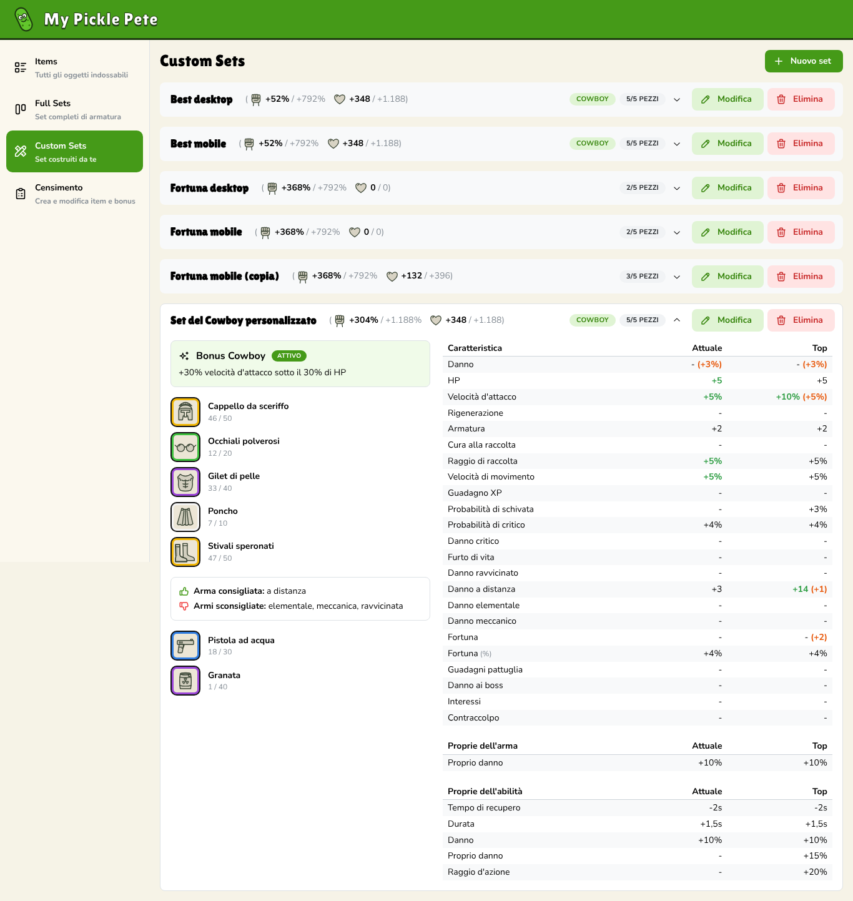
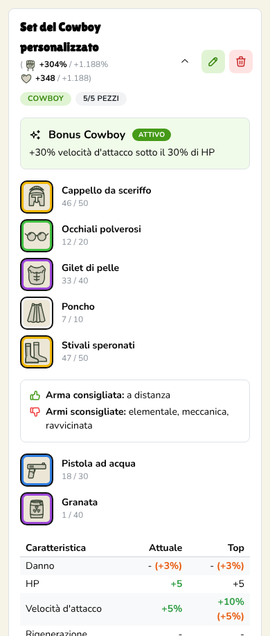

# My Pickle Pete

A personal companion web app for the Android game *Pickle Pete: Survivor*: it keeps an inventory of the player's equipment and works out which armor combination gives the best stats. Built for my own use, with an Italian UI that works on desktop and mobile.

## Features

- **Items**: inventory of armor pieces, weapons and abilities with filters; each item tracks its rarity and level, which can be changed in place with live Danno/HP updates.
- **Full Sets**: the game's 11 armor sets, each showing owned pieces, the 4-of-5 set bonus (active or not), recommended and discouraged weapon types, and a stat table comparing current values with the maximum reachable ("Top").
- **Custom Sets**: user-built loadouts of five armor pieces plus one weapon and one ability, with a stat-delta preview when hovering (or long-pressing) a candidate piece.
- **Best now / Best potential**: exhaustive search over owned armor for the combination that maximises a chosen primary stat (and optional secondary stat), at current rarity or at maximum rarity.
- **Census**: there is no public item database for the game, so items are entered by hand: type, slot, set and the five per-rarity bonuses (flat or %), with validation.
- **Responsive**: the side menu collapses into a burger menu and modals go full screen on phones.

<table>
  <tr>
    <td></td>
    <td></td>
  </tr>
</table>

## Architecture

```
React SPA (TypeScript)  ──  JSON over HTTP /my-pickle-pete/api/**  ──>  Spring Boot (Java)  ──  jOOQ  ──>  H2 (file)
```

- **Backend** (`backend/`, Java / Spring Boot): REST API for items, armor sets, custom sets and game constants. Owns all the domain logic: per-rarity bonus validation, set statistics, set-bonus activation, weapon advice and the best-set search. Layered as `application` (REST endpoints, request/response DTOs), `core` (domain model, enums, services, calculators) and `infrastructure` (jOOQ repositories, exception handling). The schema is managed with Liquibase, and jOOQ classes are generated from the Liquibase changelog at build time. OpenAPI docs via springdoc.
- **Frontend** (`frontend/`, TypeScript / React): single-page app built with Vite and Mantine. It renders the pages and calls the backend through a small typed fetch client with TanStack Query for caching.
- **How they talk**: in production the backend serves the built frontend as static files from the same origin, so the whole app lives at a single URL (`http://localhost:8080/my-pickle-pete/`). In development the Vite dev server proxies `/my-pickle-pete/api` to the backend.

## Stack

| Layer    | Technology |
|----------|------------|
| Backend  | **Java 25**, Spring Boot 4.0.8 (Web MVC, Validation, virtual threads), jOOQ, Liquibase, H2 2.5.252, springdoc-openapi 3.0.3, Maven (wrapper included) |
| Frontend | **TypeScript 5.9**, React 19.3, Vite 8.3, Mantine 9.7, TanStack Query 5, Tabler Icons |
| Tooling  | JUnit 5 + Spring Boot Test; Vitest 5 + Testing Library + jsdom; ESLint 10, Prettier 3 |

## Getting started

Prerequisites: **JDK 25** and **Node.js 22+**.

```bash
# 1. Build the frontend (the backend serves frontend/dist)
cd frontend
npm install
npm run build

# 2. Start the backend
cd ../backend
./mvnw spring-boot:run        # Windows: mvnw.cmd spring-boot:run
```

Open <http://localhost:8080/my-pickle-pete/>. API docs: <http://localhost:8080/my-pickle-pete/swagger-ui.html>.

On Windows, `avvia.bat` does all of the above: it reads `JAVA_HOME` from `.env` (copy `.env.example`), rebuilds the frontend when the code has changed, starts the backend and opens the browser.

For frontend development with hot reload, keep the backend running and run `npm run dev` in `frontend/` (<http://localhost:5173/my-pickle-pete/>).

Data is stored in an H2 file under `backend/data/` (git-ignored). Optional environment variables: `MPP_PORT` (default `8080`), `MPP_SERVER_ADDRESS` (default `127.0.0.1`; set `0.0.0.0` to reach it from a phone on the same Wi-Fi), `MPP_DB_PATH`, `MPP_FRONTEND_DIST`.

## Testing

```bash
cd backend && ./mvnw test     # unit tests + Spring Boot integration tests on in-memory H2
cd frontend && npm test       # Vitest: domain logic and page tests
```

---

Backend designed and written by me; frontend generated with Claude Code under my direction.
